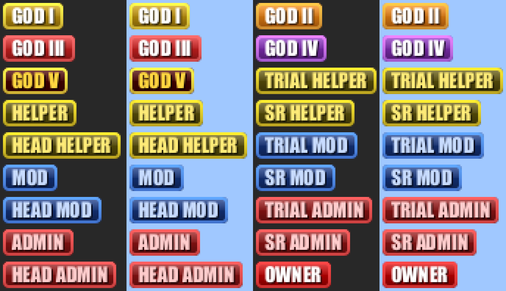

# NullCraftPrefixes

Graphic rank badges for Paper 1.21. The plugin serves its own resource pack and shows text badges to players who do not have the pack loaded.



*All 18 badges on a dark and a light background, enlarged 4x.*

Each rank's badge is a small image mapped to a private-use font character, so a LuckPerms prefix of a single character shows a graphic badge in chat, in the TAB list and in join messages. A player who has not loaded the pack would see an empty box instead. This happens when they declined the pack, turned server packs off or are still downloading it. NullCraftPrefixes detects this for each player and shows them a coloured text badge such as `[ADMIN]` instead, while players with the pack see the image.

## Features

- **Self-hosted resource pack**: the pack is bundled inside the jar and served by a small built-in HTTP server, so no external web host is needed. You can also point servers at a pack hosted elsewhere, so one server serves it and the others only send it.
- **Sent on join**: configurable delay, a MiniMessage prompt on the download screen, and an optional "required" mode. The pack is added next to any other server pack instead of replacing it, because 1.20.3+ clients keep several packs at once.
- **Content-addressed pack**: the pack id and file name come from the pack's SHA-1. Clients download it again only when the pack really changes, and switching between servers that send the same pack does not reload the client's resources.
- **Text fallback for each viewer**: the plugin tracks every player's pack status. Players without the pack see a configurable MiniMessage text badge in place of the image in:
  - chat (it wraps whatever renderer your chat plugin, such as LPC, has already set),
  - join and quit messages,
  - the TAB list, through the relational placeholder `%rel_nullcraft_prefix%`.

  The console always gets the text form.
- **PlaceholderAPI and LuckPerms integration**: placeholders return a player's LuckPerms prefix, either raw or as the viewer should see it.
- **Custom item models across 1.21.x**: the same pack carries the network's custom item models (currently an animated `god_blade` model for the netherite sword). Clients on 1.21.4 and newer pick the model by its `custom_model_data` string. Clients on 1.21-1.21.3, connecting through ViaBackwards, only understand a number, so the plugin adds the matching number to those items. It does this on join, on pickup, when a container opens, and every 5 seconds.
- **18 badges**: GOD I-V tiers; Trial, regular, Senior and Head for Helper, Mod and Admin; and Owner.
- **Pack tooling included**: a dependency-free Python script builds the pack, and a Java script renders the high-resolution badge art.

## Requirements

| | |
|---|---|
| Server | Paper (or a Paper fork) for Minecraft 1.21.x. The plugin is compiled against the Paper 1.21.11 API, and the item-model feature uses the custom-model-data component API added in 1.21.4, so run 1.21.4 or newer. It uses Paper's chat-renderer and Adventure APIs, so plain Spigot is not supported. |
| Players | The pack declares pack format 22 and up, so clients from 1.20.3 accept it. Its content targets 1.21-1.21.11. |
| Java | 21 or newer |
| Optional | [LuckPerms](https://luckperms.net/) and [PlaceholderAPI](https://www.spigotmc.org/resources/placeholderapi.6245/): both are needed for the placeholders. A chat plugin that shows LuckPerms prefixes (for example LPC). TAB to show badges in the player list. ViaVersion/ViaBackwards if 1.21-1.21.3 clients join a newer server. |
| Network | One TCP port that players can reach, for the built-in HTTP server. Not needed if the pack is hosted elsewhere. |

## Installation

Install the plugin on your Paper backend servers, not on the proxy.

### Single server

1. Build the jar (see [Building](#building)) and copy `target/NullCraftPrefixes-1.1.0.jar` into `plugins/`.
2. Start the server once to create `plugins/NullCraftPrefixes/config.yml`, then stop it.
3. Set `http.public-host` to your server's IP or domain, and set `http.port` to a free TCP port that players can reach.
4. Start the server. The log confirms the pack and the download address:
   ```
   Pack ready (35 KB, 18 text badges, 1 custom item models for 1.21-1.21.3): http://<host>:<port>/nullcraft-pack-<hash>.zip
   ```
5. Give each LuckPerms group its badge as a prefix (see [Setting up the badges](#setting-up-the-badges)).

### Several backend servers

Serve the pack from one server and only send it from the others:

- **Serving server**: keep `http.enabled: true` and set `http.port` and `http.public-host` as above.
- **Every other server**: install the same jar and set
  ```yaml
  http:
    enabled: false
  pack:
    url: "http://<serving-host>:<port>/{file}"
  ```
  `{file}` is replaced with the pack's current file name, which changes whenever the pack does. All servers must therefore run the same build of the plugin.

Avoid sending a second resource pack that defines the same font characters, because the two packs would compete for them.

### Setting up the badges

Each rank has one badge character in the private-use range U+E100-U+E111. Set it as the LuckPerms prefix of the matching group:

```
lp group <group> meta setprefix <priority> "&f<badge> &e"
```

The `&f` before the badge keeps the badge's own colours. The colour code after it is the colour of the player's name. The keys of the `badges:` section in `config.yml` are the badge characters themselves, so you can copy them from there.

| Group | Badge | Character |
|---|---|---|
| `godtier1` | GOD I | U+E100 |
| `godtier2` | GOD II | U+E101 |
| `godtier3` | GOD III | U+E102 |
| `godtier4` | GOD IV | U+E103 |
| `godtier5` | GOD V | U+E104 |
| `trial-helper` | TRIAL HELPER | U+E105 |
| `helper` | HELPER | U+E106 |
| `senior-helper` | SR HELPER | U+E107 |
| `head-helper` | HEAD HELPER | U+E108 |
| `trial-mod` | TRIAL MOD | U+E109 |
| `mod` | MOD | U+E10A |
| `senior-mod` | SR MOD | U+E10B |
| `head-mod` | HEAD MOD | U+E10C |
| `trial-admin` | TRIAL ADMIN | U+E10D |
| `admin` | ADMIN | U+E10E |
| `senior-admin` | SR ADMIN | U+E10F |
| `head-admin` | HEAD ADMIN | U+E110 |
| `owner` | OWNER | U+E111 |

The same mapping is kept in `tools/mapping.tsv`.

## Commands and permissions

None. The plugin has no commands and no permissions. It is configured entirely through `config.yml`. Restart the server to apply changes, because there is no reload command.

## Placeholders

These are registered only when both PlaceholderAPI and LuckPerms are enabled.

| Placeholder | Returns |
|---|---|
| `%rel_nullcraft_prefix%` | Relational. The target player's LuckPerms prefix as the viewer should see it: the badge if the viewer has loaded the pack, otherwise the text form. Meant for TAB, which shows one player's prefix to many viewers. |
| `%nullcraft_prefix%` | The player's LuckPerms prefix exactly as LuckPerms stores it. |

## Configuration

`plugins/NullCraftPrefixes/config.yml`:

| Key | Default | Description |
|---|---|---|
| `http.enabled` | `true` | Serve the pack from this server's built-in HTTP server. Set it to `false` on servers that only send the pack. |
| `http.port` | set your own | TCP port of the built-in HTTP server. It must be free and reachable by players. |
| `http.public-host` | set your own | The public address players download the pack from: your server's IP or domain. |
| `pack.url` | `""` | Full download URL. When empty, the plugin uses `http://<public-host>:<port>/<file>`. `{file}` is replaced with the pack's file name. Required on servers with `http.enabled: false`. |
| `pack.required` | `false` | `true` kicks players who decline the pack. With `false`, those players see the text badges instead. |
| `pack.prompt` | NULLCRAFT gradient text | The text on the download screen, as [MiniMessage](https://docs.advntr.dev/minimessage/format.html). |
| `pack.delay-ticks` | `20` | Ticks to wait after a player joins before sending the pack. |
| `pack.log-status` | `true` | Log each player's response to the pack (loaded, declined, failed download, ...). |
| `badges` | all 18 ranks | Map of badge character to the MiniMessage text that players without the pack see, for example `<dark_gray>[</dark_gray><red>ADMIN</red><dark_gray>]</dark_gray>`. |
| `legacy-item-models` | `god_blade: 1001` | Map of `custom_model_data` string to the number given to that item for 1.21-1.21.3 clients. Keep it in step with `LEGACY_MODEL_IDS` in `tools/make_pack.py`. |

If a config from an older version has no `badges` or `legacy-item-models` section, the built-in defaults are used.

Items get a custom model through their `custom_model_data` string, for example:

```
/give @s netherite_sword[minecraft:custom_model_data={strings:["god_blade"]}]
```

## Building

You need JDK 21 and Maven 3. Python 3 is needed only to rebuild the resource pack.

The generated pack is committed at `src/main/resources/prefix-pack.zip`, so a normal build only needs Maven:

```bash
git clone https://github.com/leemurzaev/NullCraftPrefixes.git
cd NullCraftPrefixes
mvn package
```

The jar is written to `target/NullCraftPrefixes-1.1.0.jar`, with the pack inside it.

### Rebuilding the resource pack

Run these commands from the project root:

1. **(Optional) Render the high-resolution badge art.**
   ```bash
   java tools/BadgeArt.java tools/badges
   ```
   This draws every badge 18 px tall, twice Minecraft's GUI resolution, with a gradient body, gloss, border and shadowed text. It writes `tools/badges/badge_<group>.png` and `tools/badges/preview.png`. It uses Impact, Arial Black or Arial Bold from the Windows fonts folder when one is available and otherwise falls back to Java's bold sans-serif font, so the art looks different on other systems.

2. **Build the pack.**
   ```bash
   python tools/make_pack.py > tools/mapping.tsv
   ```
   (Use `python3` on most Linux and macOS systems.) The script uses only the Python standard library. It writes `src/main/resources/prefix-pack.zip` and prints the group / label / character mapping, which the command above saves to `tools/mapping.tsv`. For each rank it uses the PNG in `tools/badges/` if one exists and otherwise draws a 9 px badge with its built-in pixel font. It also adds:
   - the font definition (9 px high, so a badge fits on one chat line),
   - the custom item models: 1.21.4+ item definitions plus legacy overrides for 1.21-1.21.3,
   - everything under `tools/pack-assets/` (pack icon, model and texture files).

   Zip entries are written in sorted order with a fixed timestamp. An unchanged pack therefore produces an identical file and hash, and players are not asked to download it again.

3. **Package the plugin.**
   ```bash
   mvn package
   ```

### Adding a rank or a custom item

- **Rank**: add an entry at the end of `BADGES` in `tools/make_pack.py`, and to `badges()` in `tools/BadgeArt.java` for the high-resolution art. Adding it at the end keeps the characters of the existing ranks. Then add its text form under `badges:` in `src/main/resources/config.yml`, and in `plugins/NullCraftPrefixes/config.yml` on servers that already have a config. Rebuild.
- **Custom item**: put the model and texture under `tools/pack-assets/assets/<namespace>/`, register the item in `CUSTOM_ITEMS` (and its base model in `VANILLA_ITEM_MODELS`), and give it a number in `LEGACY_MODEL_IDS`. Add the same number under `legacy-item-models:` in the config. Rebuild.

### Project layout

```
src/main/java/dev/nullcraft/prefixes/
  NullCraftPrefixes.java   plugin entry point: pack loading, HTTP server, sending the pack, pack status
  BadgeMessages.java       per-viewer chat and join/quit messages
  BadgePlaceholders.java   PlaceholderAPI expansion (LuckPerms prefixes)
  Badges.java              badge characters and their text forms
  LegacyItemModels.java    custom_model_data numbers for 1.21-1.21.3 clients
src/main/resources/
  plugin.yml, config.yml
  prefix-pack.zip          generated by tools/make_pack.py
tools/
  BadgeArt.java            high-resolution badge renderer
  make_pack.py             resource pack builder
  mapping.tsv              group / label / character mapping
  badges/                  rendered badge PNGs and preview
  pack-assets/             extra pack files (icon, custom item model and texture)
```

## About

Built for the NullCraft Minecraft network by [ParkDawg](https://github.com/leemurzaev).
